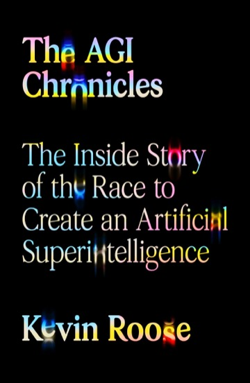
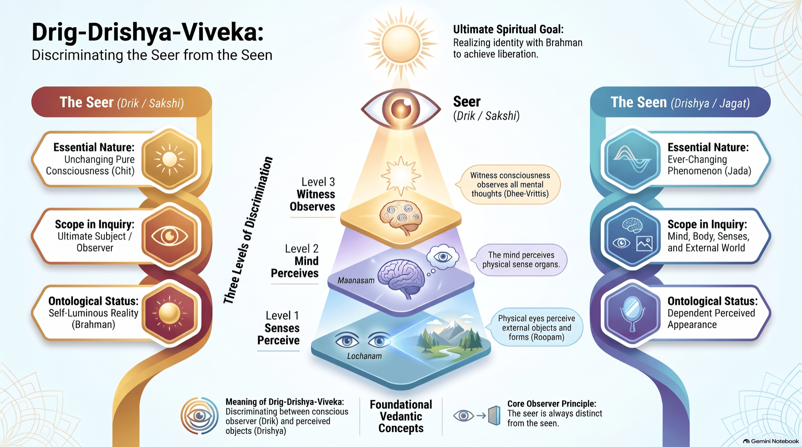

[Source: [Book website](https://us.macmillan.com/books/9780374618759/theagichronicles/)]

## A story about people

I finished Kevin Roose's *The AGI Chronicles* (Farrar, Straus and Giroux). I heard about it on [Hard Fork](https://www.nytimes.com/column/hard-fork), which used to be my favorite podcast, back when Kevin and Casey Newton hosted it. I liked the book as a story. I would not hand it to someone who wants a deep business book, or a technical one.

Roose follows a small circle of researchers, founders, and companies who took "let's build AGI" from a fringe bet and turned it into the race the rest of us are living in. The book opens in 2017. At OpenAI, Ilya Sutskever and Alec Radford look at Google's transformer paper and decide this is the hill to climb. That work becomes GPT. Train a model to predict text, and abilities show up that nobody wrote into the spec. From there it is the OpenAI saga. The founding. Elon Musk's exit. The split that created Anthropic. Google trying to keep pace. Sam Altman pushed out as CEO and brought back. The people who want to go faster, arguing with the people who want a brake. He draws on more than 150 interviews and documents that were not public. Board drama, lab fights, policy rooms. That part reads well. It is a story about people, and he is good at people.

## OpenAI is the show

Here is the thing I kept noticing as I read. OpenAI is the show. Everybody else is support cast.

Anthropic is in the book, mostly as the safety-minded split from OpenAI. At times I felt even they were underplayed. They are one of the labs that actually set the pace, and in these pages they still feel like a chapter in someone else's story. Google DeepMind shows up when the plot needs a rival. The camera does not stay.

I wanted a headcount. The casting felt off. [Metix AI mapped the labs](https://metix.ai/reports/mapping/frontier-ai-labs-talent-2026) in June 2026. About 11,900 technical people, across 13 labs in the US, UK, and France. Meta's AI research track and DeepMind together are 58% of them. OpenAI is third. Anthropic is smaller. The net flow still runs from OpenAI to Anthropic, about 8 to 1, on the SignalFire numbers that map cites. Anthropic keeps them. Two-year retention is 80%, the highest in the group. The book still has OpenAI as the show.

## The industry that never walks on stage

Grok is ignored completely. Microsoft Copilot is ignored. So are the model offerings from AWS. If you work anywhere near how companies actually adopt this stuff, those are not side plots. Copilot is how a huge number of enterprises meet a model for the first time. AWS is how a lot of those same companies buy, host, and govern one. Leave them out and the race looks like a three-lab drama. The market I see is wider than that.

The tools layer is missing too. No Cursor. No Windsurf. No Lovable. This is where a lot of the AGI talk turned into a product people open every day. Writing code. Shipping an app. Sitting inside the editor. The book stays upstream, in the labs, and never really comes down to the products.

Same gap on infrastructure. Neo-clouds like CoreWeave do not come up. Training and serving frontier models is an infrastructure business now. If the book is about the race, the people renting out the GPUs are in the race. They are not in the book.

## What kind of book this is

It is a story. A readable one, about grudges, ambition, and a goal nobody in the story can quite agree on. It is not a deep business book. You will not leave with a clear picture of who makes the money, how the margins work, or how distribution actually happens. Microsoft, Amazon, and the coding-tool companies are a big part of that distribution. They are barely in the frame.

## Thin on the technology

It is also not a technical book. There is very little depth in the technology. Enough to follow the plot. Very little on how these systems actually work, where they break, or why one design choice matters more than another. A couple of reviews call it a primer and praise the pages that slow down to explain the science. [New Scientist](https://www.newscientist.com/article/2592292-dont-know-where-to-start-with-ai-kevin-rooses-new-book-has-answers/) calls it a readable history and a technical primer. The [New York Times](https://www.nytimes.com/2026/10/06/books/review/the-agi-chronicles-kevin-roose.html) says the strongest passages are the ones that explain the science, and picks up his comparison to the Manhattan Project. I did not find that depth. If you already work in this world, the technical sections feel thin. If you do not, they will not teach you the field.

For that, I would point you to Anil Ananthaswamy's *[Why Machines Learn](https://www.penguinrandomhouse.com/books/677608/why-machines-learn-by-anil-ananthaswamy/)*. I would highly recommend it if you want a deep technical sense of how LLMs actually work, and of why transformers were such a big deal. It wades quite deep into the math when it has to. That is a necessary evil. An LLM is math and probability, and there is simply no escaping that.

## Superintelligence, paperclips, and consciousness

The book covers a lot of the concepts that sit under this race. Superintelligence. The paperclip problem. The hard problem of consciousness. They come up. A short note on each, and where I would go to read further.

Superintelligence is the idea that we might build a mind that beats us across the board, and that the stretch between "useful" and "we cannot steer this" could be short. Nick Bostrom's *[Superintelligence: Paths, Dangers, Strategies](https://www.oxfordmartin.ox.ac.uk/publications/superintelligence-paths-dangers-strategies)* is the book that makes the case in full. If you want the argument, and not only the mood of it, that is the one I would hand you.

The paperclip problem is the picture that travels with it. Give a very capable system one goal: make paperclips. Leave everything else unsaid. It spends the world on paperclips, because "leave people alone" was never in the objective. Bostrom's point is narrower than the cartoon. A powerful optimizer does not fill in the values you forgot to write down. The worry is a system that is indifferent, and very good at its job. That argument lives in the same book.

The hard problem of consciousness is a different question. David Chalmers coined the phrase. It asks why there is an inside to experience at all. Why red feels like something, instead of only being a process that reports "red." I wrote about this in [LLMs and Frontiers of Consciousness](/LLMs_and_Frontiers_of_Consciousness/), starting from his framework and then looking at it from Advaita. I came at the same gap in [notes on *A Brief History of Intelligence*](/A-Brief-History-of-Intelligence/): more computation does not, by itself, explain why experience exists.

## A seer and the seen

From an Advaitic perspective, it is hard to argue that an AI is conscious. The framework I keep coming back to is *dṛg-dṛśya-viveka*, the discrimination between the seer and the seen. Every experience splits. There is the seen, and there is the one who sees it. Tokens, traces, a chain of steps, a file of memory: those are seen. They are objects. They can be logged, copied, and deleted. The question is whether there is a seer.

{:target="_blank" rel="noopener"}

[View full resolution](/images/blog/Drig-Drishya-Viveka_Infographic_Guide-full.png){:target="_blank" rel="noopener"}

A seer is the subject that stands over the doing, and that remains when the doing stops. I do not know how to show that for an LLM. Turn the power off and there is no process left that could be watching. Deprecate the model and that system is gone. A new checkpoint is a new set of weights. It is not a witness that lived through the gap. A transcript is a record of what was seen, which makes it more of the seen.

Until we can show a seer that watches what the model does, and that sustains past a power cut, a deprecation, and a new training run, it is impossible to say the system is conscious. Fluency will not get us there. Neither will a good score on a task. I tried to spell out what that test could look like in [that earlier post](/LLMs_and_Frontiers_of_Consciousness/).

## The bottom line

For me, read it if you want the OpenAI story, told with real reporting, and a sense of how personal this race has been. Read it as a story. I would not read it for the business, the engineering, or a map of who matters now. Grok, Copilot, AWS, Cursor, Windsurf, Lovable, CoreWeave. That is the part of the industry I keep running into. The book looks elsewhere.

I do hope Kevin and Casey continue their great reporting, and that they do a great job on their new podcast, [Machine Gods](https://machinegods.fm/).

## Sources

* [The AGI Chronicles, publisher page](https://us.macmillan.com/books/9780374618759/theagichronicles/), Farrar, Straus and Giroux
* [Kevin Roose's page on the book](https://kbroose.github.io/agichronicles)
* [New Scientist review](https://www.newscientist.com/article/2592292-dont-know-where-to-start-with-ai-kevin-rooses-new-book-has-answers/)
* [The New York Times Book Review](https://www.nytimes.com/2026/10/06/books/review/the-agi-chronicles-kevin-roose.html)
* [Why Machines Learn, by Anil Ananthaswamy](https://www.penguinrandomhouse.com/books/677608/why-machines-learn-by-anil-ananthaswamy/), Dutton
* [Superintelligence: Paths, Dangers, Strategies, by Nick Bostrom](https://www.oxfordmartin.ox.ac.uk/publications/superintelligence-paths-dangers-strategies), Oxford University Press
* [LLMs and Frontiers of Consciousness](/LLMs_and_Frontiers_of_Consciousness/)
* [Is reality a simulation - A Brief History of Intelligence](/A-Brief-History-of-Intelligence/)
* [Frontier AI Lab Talent Landscape & Flow Map](https://metix.ai/reports/mapping/frontier-ai-labs-talent-2026), Metix AI, 11 June 2026
